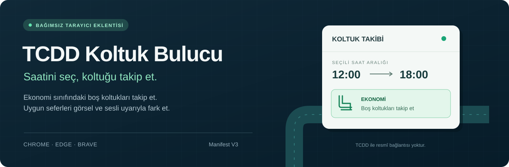

<p align="center">
  
</p>

<p align="center">
  <a href="https://github.com/SenseiTuna/TCDD-Koltuk-Bulucu/releases/latest"></a>
  
  
</p>

<p align="center">
  TCDD e-Bilet sefer listesinde, seçtiğin saat aralığındaki <strong>ekonomi sınıfı boş koltukları</strong> takip eden ücretsiz tarayıcı eklentisi.
</p>

<p align="center">
  <strong><a href="https://github.com/SenseiTuna/TCDD-Koltuk-Bulucu/releases/latest">↓ Son sürümü indir</a></strong>
  &nbsp; · &nbsp; <a href="#kurulum">Kurulum</a>
  &nbsp; · &nbsp; <a href="#kullanım">Kullanım</a>
  &nbsp; · &nbsp; <a href="https://github.com/SenseiTuna/TCDD-Koltuk-Bulucu/issues/new/choose">Sorun bildir</a>
</p>

---

## Neler yapar?

| Özellik | Nasıl çalışır? |
| --- | --- |
| **Saat aralığı** | Yalnız seçtiğin aralıktaki seferleri kontrol eder. `22:00–04:00` gibi gece yarısını aşan aralıkları da destekler. |
| **Ekonomi takibi** | En az bir boş ekonomi koltuğu bulunan uygun seferleri listeler. |
| **Görsel vurgu** | Uygun sefer kartını ve ekonomi butonunu yeşil çerçeveyle işaretler. |
| **Ses ve bildirim** | Tarayıcı izin verdiğinde kısa sesli uyarı ve masaüstü bildirimi üretir. |
| **Otomatik kontrol** | Sayfayı 10 saniyede bir tarar; uygun koltuk yokken yaklaşık 60 saniyede bir yeniler. |
| **Kontrol sende** | Paneldeki **Aktif** seçeneğiyle duraklatılır. Koltuk haritasında tarama ve yenileme durur. |

> Eklenti koltuk takibi yapar. Bilet satın alma ve rezervasyon adımlarını sen tamamlarsın; koltuk bulunması satın alma garantisi değildir.

## Kurulum

**Chrome, Edge veya Brave gibi Chromium tabanlı bir tarayıcı kullan.**

1. [Son sürüm sayfasını](https://github.com/SenseiTuna/TCDD-Koltuk-Bulucu/releases/latest) aç; **Assets** altındaki `TCDD-Koltuk-Bulucu-v1.0.zip` paketini indir.
2. ZIP'in **tamamını** kalıcı bir klasöre çıkar.
3. Tarayıcının adres çubuğuna uzantılar sayfasını yaz:

   | Tarayıcı | Adres |
   | --- | --- |
   | Chrome | `chrome://extensions/` |
   | Edge | `edge://extensions/` |
   | Brave | `brave://extensions/` |

4. **Geliştirici modu** seçeneğini aç ve **Paketlenmemiş öğe yükle / Load unpacked** düğmesine bas.
5. İçinde `manifest.json`, `script.js` ve `icon.png` bulunan klasörü seç.
6. Açık TCDD e-Bilet sekmesini bir kez yenile.

GitHub'ın otomatik oluşturduğu **Source code** arşivi de kaynakları içerir; kurulum için yukarıdaki hazır eklenti ZIP'ini kullanmak daha pratiktir. Eklenti klasörünü kurulumdan sonra silme veya taşıma.

## Kullanım

1. [TCDD e-Bilet](https://ebilet.tcddtasimacilik.gov.tr/) üzerinde kalkış, varış ve seyahat tarihini seçerek arama yap.
2. Sefer listesinde sağ üstteki **TCDD Koltuk Yakalama** panelinden başlangıç ve bitiş saatini belirle.
3. **Kaydet** düğmesine bas; **Aktif** seçeneği açık kalsın.
4. Sekmeyi açık, bilgisayarı uyanık tut. Uygun koltuk bulunduğunda yeşil işaretli seferi kontrol ederek satın alma işlemine kendin devam et.

Varsayılan saat aralığı **12:00–18:00**'dır. Kaydettiğin saat aralığı ve aktiflik tercihi TCDD sitesinin yerel tarayıcı depolamasında tutulur. Tarih ve güzergâhı eklenti panelinden değil, TCDD aramasından seçersin.

<details>
<summary><strong>Bildirim gelmiyor, ses yok veya panel görünmüyor mu?</strong></summary>

- **Panel görünmüyor:** Eklentinin etkin olduğunu ve doğru klasörü yüklediğini kontrol et; TCDD sekmesini yenile. Takip yalnız `/sefer-listesi` sayfasında çalışır.
- **Masaüstü bildirimi yok:** Bildirimler tarayıcı ve işletim sistemi izinlerine bağlıdır. TCDD sitesi için bildirim iznini kontrol et; izin isteği tarayıcı tarafından sınırlandırılabilir.
- **Ses yok:** Tarayıcı otomatik sesi engelleyebilir. TCDD sayfasında etkileşimde bulun ve sekmenin sesinin kapalı olmadığını kontrol et.
- **Yenileme gecikiyor:** Uyku modu ve arka plan sekmesi kısıtlamaları zamanlayıcıları yavaşlatabilir. Bilgisayar açık ve uyanık kalmalıdır.
- **Seferler algılanmıyor:** TCDD sayfasının yapısı değişmiş olabilir. Kişisel bilgileri gizleyerek bir [hata bildirimi](https://github.com/SenseiTuna/TCDD-Koltuk-Bulucu/issues/new/choose) açabilirsin.

</details>

## İzinler ve gizlilik

Manifest V3 içerik betiği yalnız `https://ebilet.tcddtasimacilik.gov.tr/*` adreslerinde çalışır. Manifest ek uzantı izinleri istemez; masaüstü bildirimi için tarayıcının site bildirim izni kullanılır. Kodda analitik, harici veri toplama servisi veya ayrı bir sunucuya veri gönderimi bulunmaz. Ayarlar ve son bildirim zamanları tarayıcıdaki `localStorage` içinde saklanır.

Bu proje TCDD veya TCDD Taşımacılık A.Ş. tarafından yayımlanmamıştır; bağımsız bir yardımcı araçtır. Sitenin yapısındaki değişiklikler eklentinin çalışmasını etkileyebilir. Çok sık sayfa yenilemekten kaçın; mevcut varsayılan yenileme aralığı **60 saniyedir**.

## Geliştirme ve paketleme

Eklentiyi çalıştırmak için Node.js, Python veya derleme adımı gerekmez; repo klasörü doğrudan paketlenmemiş uzantı olarak yüklenebilir. JavaScript sözdizimini kontrol etmek için Node.js ile `node --check script.js` çalıştırılabilir.

Yeni dağıtım paketi oluşturmak için Python 3.10+ ile:

```sh
python tools/package_extension.py
```

Betik manifest referanslarını doğrular ve yalnız üç çalışma dosyasını ZIP'e alır. `dist/` altında sürümlü ZIP ile `SHA256SUMS.txt` oluşur. Paket içindeki `manifest.json` doğrudan kök dizindedir. Kaynak kodu ve belgeler GitHub'daki repoda bulunur.

Sürüm geçmişi için [değişiklik notlarına](CHANGELOG.md), katkı için [katkı rehberine](CONTRIBUTING.md) bakabilirsin. Yeni sürüm yayımlarken önce `manifest.json` içindeki sürümü ve değişiklik notlarını güncelle, ardından paketi oluşturup aynı sürüm etiketiyle release'e ekle.
